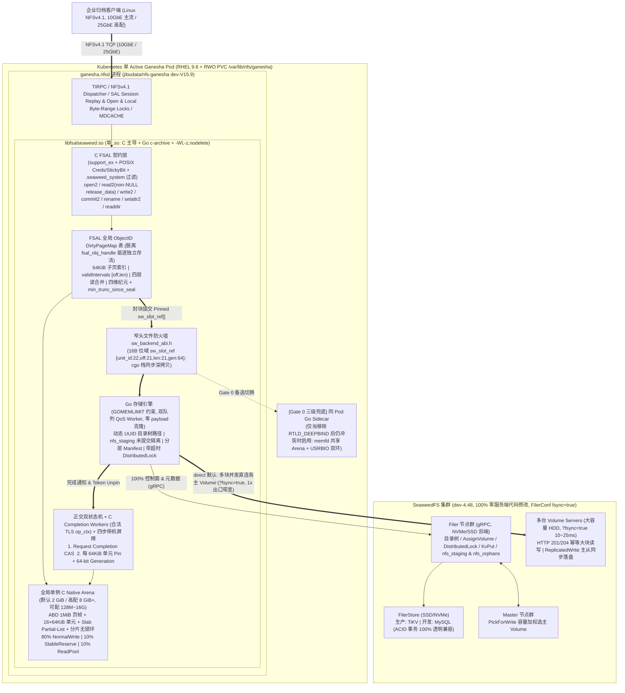

# FSAL_SEAWEED：以单个原生 Ganesha FSAL 与有界 C Arena 构建面向 SeaweedFS 的零静默丢数 NFSv4.1 归档网关（PRD & 架构设计合一冻结稿）

* **版本**：`v0.4.1`（独立对抗评审闭环与实施契约冻结稿 — 全部 10 项 `P0` 与 8 项 `P1` 修复已合入，准入 Gate 0 / Gate 1）
* **作者**：`jerry-jibu` & Storage Architecture Team
* **更新日期**：`2026-11-19`
* **状态**：`Frozen Implementation Contract`（SeaweedFS 服务端零修改已锁定；`jibudata/nfs-ganesha` 两处最小宿主安全适配已批准）
* **代码、硬件与工具链核实基线**：
  * **NFS-Ganesha（自有仓库 `jibudata/nfs-ganesha`）**：`dev-V15.9`（Commit `42bc41b62c12346aea30357cb613944e1032890b`；允许 2 处几行级宿主安全适配：① `fsal_manager.c` 支持对 `FSAL_SEAWEED` 按需移除 `RTLD_DEEPBIND`；② `nfs_init.c` 崩溃信号处理器补 `SA_ONSTACK`）
  * **SeaweedFS**：`dev-4.48`（Commit `530be3e37337488ecc34d58441e0bc476e121c93`，**v1 严格坚持 100% 零修改 SeaweedFS 服务端代码，即插即用兼容现有与上游集群**）
  * **宿主机与容器基线**：Kubernetes 单 Active Pod（挂载小型 RWO PVC 持久化 `/var/lib/nfs/ganesha` 恢复目录），宿主机 **RHEL 9.6**（Linux `5.14`，默认 `kernel.io_uring_disabled = 2`）
  * **物理硬件与网络基线（已锁定）**：
    * **控制/元数据面（Filer + TiKV / MySQL）**：独立部署于 **SSD / NVMe**（低延迟 ACID 事务；强制集群配置 `fs.configure -locationPrefix=/ -fsync=true`）；
    * **数据存储面（SeaweedFS Volume Server）**：部署于 **高密度大容量机械盘（HDD，单次 `?fsync=true` 落盘延迟约 `10 ~ 25 ms`）**；与 `weed mount` 当前行为保持严格一致（禁用 `Entry.Content` 内联），**所有大小文件数据统一落入 HDD Volume**；
    * **网关资源与前端网络**：主流前端网卡 **`10GbE`**（少数高配客户 **`25GbE`**）；C Native Arena 常规配置 **`2 GiB`**，高吞吐/25GbE 场景按需配置 **`8 GiB+`**（支持可配范围 **`128 MiB ~ 16 GiB`**）。
  * **形式化与验证三工具基线**：**Lean `4.14.0` + Lake `5.0.0`**（`Makefile` 现行 `v0.3.4` 7 模块 32 条定理已实跑通过，Gate 0/1 同步对齐至 `v0.4.1` 语义）+ **CBMC & C Sanitizers/libFuzzer** + **Go 确定性仿真（DST）与离散事件性能仿真器**。

> [!IMPORTANT]
> **`v0.4 -> v0.4.1` 独立对抗评审闭环摘要（响应 `fsal_seaweed_v0.4_independent_review.md` 全部 10 项 `P0` 与 8 项 `P1`）**
> 1. **文件类型与宿主边界拍板（`P0-01`、`P0-10`、`P1-01`、`P1-06`）**：v1 归档场景**关闭普通文件硬链接 `LINK`**（`fs_info.link_support = false` 返回 `NFS4ERR_NOTSUPP`，**100% 支持符号链接 `SYMLINK`/`READLINK`**），彻底规避上游 `filer_grpc_server_rename.go` 覆盖硬链接误删块 Bug；坚持 **SeaweedFS 服务端 0 代码修改**，批准自有仓 `jibudata/nfs-ganesha` 2 处宿主安全适配；单 Active 独占下**字节范围锁由 Ganesha SAL 本地内存权威管理**（`fs_info.lock_support = false`，规避 Filer 15s 硬编码常量 TTL）。
> 2. **消除四类静默丢数与数据污染漏洞（`P0-02`、`P0-03`、`P0-04`、`P0-06`）**：
>    * **覆盖型 `RENAME` 与动态路径**：`rename(src, dst)` 遇活跃打开的 `dst` 先移入 `nfs_orphans`；句柄严禁缓存静态路径，一律经内存目录树（`UUID -> (parent_uuid, name)`）动态拼装并置 `SkipCheckParentDirectory = true`；
>    * **跨界收缩 `TRUNCATE` 双向裁剪**：在途慢速块按 `min_trunc_since_seal` **裁剪保留合法前缀**（防误丢前缀），已持久化普通块与跨界 `ChunkManifest` 解包裁剪 `Size`（防 `entry.go` 与 `filechunk_manifest.go` 旧尾部复活）；
>    * **未提交块隐藏锚点隔离**：后台增量 `MetadataFlush` 仅写入 `/.seaweed_system/nfs_staging/<export_id>/<object_id>`（防 `volume.fsck` 误删且绝不污染已 `COMMIT` 权威文件），仅在 `COMMIT` / `FILE_SYNC4` 时合并发布；
>    * **封死 `WriteVerifier` 锁外采样撕裂与 `MDCACHE` 驱逐**：将 `C Dirty Page Map` 提升为脱离 `fsal_obj_handle` 生命周期的全局 `ObjectID` 表；`close2` 仅做非阻塞触发；凡丢弃已确认 `UNSTABLE4` 槽位，置粘性错误并在 **`commit2` 屏障内再次递增 `g_server_durability_epoch`**。
> 3. **消除缓冲区越界、`SIGABRT` 与活锁（`P0-05`、`P0-07`）**：`DirtyPageMap` 按 `64 KiB` 子页索引挂载 `Sub-Slot`（防同页跨区间越界写穿），采用 **Slab Partial-List** 聚簇装箱，并将 16B `sw_slot_ref` 升级为 **`{unit_id:22b, off:21b, len:21b} + uint64_t generation`**（每 `64 KiB` 单元独立 64-bit 代次，0 ABA）；删除 `FR-8`“连续无空洞”驱逐限制防活锁；`read2` 严禁直接零拷贝可写脏槽且强制传非空 `release_data`（防 `rpc_tools.c` `gsh_free` 崩溃）。
> 4. **补齐集群 `FilerConf` 持久闭环、网络级 Fencing 与全套 FSAL API 契约（`P0-08`、`P0-09`、`P1-02`~`P1-08`）**：强制 `FilerConf fsync=true` 覆盖服务端自发 `MaybeManifestize`；绕开无超时 `LockClient` 直调带超时 `DistributedLock` gRPC，且 Operator 切 VIP 前强制确认旧 Pod 销毁或 `NetworkPolicy` 阻断；补齐 `support_ex`、POSIX 权限与 `Sticky Bit`、`whence_is_name` 字典序 `readdir`、`.seaweed_system` 入口过滤、分层 `ChunkManifest`、HTTP `204` / `KvGet resp.Error` 防御及四步优雅停机。

---

# 第一部分：产品需求文档（PRD）

## 1. 摘要与问题背景（Abstract & Background）

### 1.1 一句话摘要
我们要构建面向 SeaweedFS 的 NFS-Ganesha 原生存储抽象层（`libfsalseaweed.so`），通过标准 NFSv4.1 协议在“NVMe 元数据 + 大容量 HDD 数据盘 + 10GbE/25GbE 网络”硬件基线上承接每天数十 TB、单文件最高 1 TB 的企业归档负载；**系统的首要承诺是“零静默丢数据”与“硬有界的确定性内存”**——凡向客户端确认 `COMMIT` 或同步写成功的数据，必已完成双副本 HDD `fsync` 落盘与 Filer 元数据持久化，且内存严格收敛在用户配置的 `2 GiB ~ 8 GiB+`（可调范围 `128 MiB ~ 16 GiB`）C Arena 预算之内。

### 1.2 目标业务负载与两类典型归档陷阱
目标客户通过备份与归档软件（如企业归档客户端、Veeam/Commvault 类备份流、`tar`、`rsync -a`、`cp -rp`）以标准 NFSv4.1 独占写入全新导出目录。虽然大文件顺序写占总字节量主体，但以下两类真实归档行为若处理不当会直接引发数据损坏或吞吐归零：
1. **陷阱一：大文件流式写完后的“回跳改写文件头/尾、覆盖改名与立即 `COMMIT/CLOSE`”**：
   归档软件先顺序写入数十至数百 GB 数据，关闭前 `lseek(0)` 覆盖写 `4 KiB ~ 64 KiB` 头部索引/校验和，随即执行 `fsync()`（触发 `COMMIT(offset=0, count=0)`）、`CLOSE` 乃至 `.tmp -> dst` 覆盖型 `RENAME`。由于 4 KiB 头部包远小于仍在 HDD 写入途中的 `32 MiB` 数据块，往往**更早上传完成**——系统既要防止晚到的旧大块反盖新文件头，又必须保证 `COMMIT` 屏障等齐**所有在途大块与新头部块**全部落盘发布后才返回成功，且未 `COMMIT` 的乱序块在崩溃时绝不能污染原已提交文件。
2. **陷阱二：目录树原格式复制（混合小文件 + `Flush/SETATTR` 紧耦合风暴）**：
   归档目录树复制会夹杂大量 `< 64 KiB` 元信息小文件与符号链接，产生密集的 `CREATE -> WRITE -> CLOSE -> SETATTR(恢复原始历史 mtime/mode/uid)`。若每个 4 KiB 小文件独占 `1 MiB` 槽位会造成 256 倍内存浪费；同时后台脏块刷盘与客户端显式恢复历史 `mtime` 的 `SETATTR` 若缺乏序列协调，会导致高频 CAS 冲突乃至后台刷盘反盖用户刚恢复的归档时间戳。

### 1.3 为什么现有 `FSAL_VFS + weed mount` 方案无法满足生产要求
1. **2~3 倍隐式 Go 堆放大与本地 Swap 抖动**：`upload_pipeline.go` 依赖无上限 `sync.Pool` 或退化写本地磁盘 `SwapFile`；`upload_content.go` 在构造 Multipart 时经 `io.ReadAll` + `bytebufferpool` 整块克隆；`weedfs_write.go` 再拷入 `chunkCache`。在 `10GbE/25GbE` 写入与 HDD `10~25 ms` 刷盘速率差下极易触发 Go GC 尖峰与容器 OOMKill。
2. **句柄跨 Rename 与重启失效**：`filer_inode.go` 用 `路径 + 秒级 Crtime` 算伪 inode，目录改名或 Pod 重启后 NFSv4.1 持久化 `filehandle4` 立即报 `NFS4ERR_STALE`。
3. **语义与 RHEL 9.6 内核限制**：FUSE 无精确区间 `COMMIT` 与单调 `writeverf`；`weedfs_file_sync.go` 曾因 Go `SIGURG` 导致 `close()` 误报 `EIO`；且 **RHEL 9.6（Linux `5.14`）** 不支持 `FUSE_PASSTHROUGH`（6.9+）与 `FUSE_OVER_IO_URING`（6.14+），并默认禁用 `io_uring`（`io_uring_disabled=2`）。

---

## 2. 产品目标与 6 项量化成功指标（Goals & Quantified Benchmarks）

对标主流企业级归档 NFS 网关（NetApp StorageGRID NFS、Dell PowerScale、CephFS Ganesha），基于真实物理定律定义可实测与仿真的硬指标：

| 指标维度 | 具体度量定义 | 归档大文件流目标值 | 目录树复制（小文件混合）目标值 |
| :--- | :--- | :--- | :--- |
| **1. 数据持久与正确性** | 故障注入（杀节点/断网/`kill -9`）后已 `COMMIT` 文件的 `sha256` 一致率 | **100% 匹配（0 字节静默丢数、0 旧尾部复活、0 未提交块污染已提交文件）** | **100% 匹配**；父目录改名/覆盖改名/重启后打开句柄 **0 非预期 `ESTALE`** |
| **2. 内存放大率 (Memory Amp)** | `实际占用 Arena 字节数 / 逻辑有效脏字节数`（全程 0 本地 Swap 文件） | **`<= 1.05x`**（1 MiB Full Slot 顺序写满） | **`<= 4.0x`**（64 KiB Sub-Slot + Slab 聚簇装箱控制 16 KiB 均值小文件开销） |
| **3. 网络/后端写放大 (Write Amp)** | `上传至 Volume 总字节数 / 客户端 WRITE 总字节数`（无故障重传与后台数据重写周期外） | **`<= 1.01x`**（网关 1× 数据出口 + `< 0.1%` 分层 `ChunkManifest` 元数据块） | **`<= 1.01x`**（Inflight 头部回跳覆盖写仅传增量有效区间，零整页回拷） |
| **4. 单实例吞吐与大小流隔离** | 大文件（`1 GiB ~ 1 TiB`）稳态带宽与混合小文件流下的带宽保护 | **`10GbE` 达 `>= 900 MB/s`**；**`25GbE`（配 `8 GiB+` Arena）达 `>= 2.2 GB/s`** | 双队列 QoS 隔离保护大文件流不饿死（注：单线程串行逐文件 `fsync` 物理上限受 HDD RTT 约束约 `30~60 files/s`，多并发客户端线性扩展） |
| **5. 尾延迟 (P99 Latency)** | `UNSTABLE4 WRITE`、`COMMIT`、`READ` 的 P99 响应时间 | **`UNSTABLE4 WRITE` P99 `< 1 ms`**；连续流水线下尾块 `COMMIT` P99 **`< 40 ms`**（突发满载排空受 `脏字节/后端带宽` 上界约束） | `CREATE + WRITE + SETATTR + CLOSE` 序列不因 CAS 自冲突出现秒级停顿，显式 `mtime` 100% 保留 |
| **6. 背压与 Filer 元数据健康度** | `NFS4ERR_DELAY` 触发占比；单文件顶层 `Entry.Chunks` 规模与 CAS 重试次数 | 稳态速率匹配后端时背压率 **`0%`**；每 512 块分层折叠使 1 TB 文件顶层块数 **`< 128`**（Entry `< 200 KiB`） | `Flush + SETATTR` 紧耦合场景平均 CAS 重试 **`<= 1.2 次`**；普通写池满时 `FILE_SYNC4` 可借 10% Reserve 即时排空 |

---

## 3. 非目标与外部职责边界（Non-Goals & Scope Boundaries）

1. **不做非 NFSv4.1 协议与高阶扩展**：不支持 NFSv3、pNFS、Delegations、NFSv4 ACL、Kerberos/`AUTH_GSS`、NFSv4.2（含 `xattr`）。
2. **v1 禁用普通文件硬链接（`LINK`）与特殊设备节点（`MKNOD`），完整支持符号链接（`SYMLINK`）**：置 `fs_info.link_support = false` 对 `OP_LINK` 返回 `NFS4ERR_NOTSUPP`，对 `mknode`（FIFO/Socket/Block/Char）返回 `NFS4ERR_NOTSUPP`；**100% 支持 `SYMLINK` 与 `READLINK`**（彻底规避上游 SeaweedFS `Rename` 覆盖硬链接误删块缺陷与归档非必需复杂度）。
3. **不做历史存量跨协议文件兼容**：不兼容或回填此前由 S3、`weed mount` 或 Filer HTTP 直接写入的无 `nfs.object_id` 文件；导出目录由本网关独占写入。
4. **不做多实例双活（Active-Active）**：v1 固定为单 Active Ganesha 实例独占 Export。
5. **不在 FSAL 内自建副本放置或少副本降级策略**：生产 3 节点 2 副本（`001`）单节点故障时“降级写 vs 拒写”由外部 SeaweedFS 集群决策，FSAL 忠实透传错误并映射标准 `NFS4ERR_*`。
6. **不做未 `fsync` 作业的透明故障接管**：VIP 漂移、旧 Pod 销毁/网络硬隔离（`NetworkPolicy`）由独立 K8s Operator 负责；failover 后未完成 `fsync`/`COMMIT` 的文件由归档客户端重传，已 `COMMIT` 文件保证 0 字节丢失。
7. **v1 暂不启用 EC 纠删码卷、加密卷、云端冷分层写入**（读路径复用 `EntryChunkGroup` 保留解析能力），不依赖 `ublk` / `FUSE_PASSTHROUGH` / `io_uring`。

---

## 4. 用户故事与可验证验收标准（User Stories）

### US-001：大文件流式归档、回跳改头、跨界截断与未提交块崩溃隔离
**描述**：作为归档客户端，我希望顺序写入最高 1 TB 文件并在关闭前执行 `lseek(0)` 头部回写、任意位置 `truncate` 裁剪与 `fsync()`，确保落入 HDD Volume 后字节内容与本地 POSIX 文件 100% 一致，且中途崩溃绝不破坏此前已 `COMMIT` 的文件数据。
**验收标准**：
- [ ] 单文件连续写入 `100 GiB` 与 `1 TiB` 后执行 `pwrite(offset=0, 16KiB)` + `fsync()` + `close()`，在途大块未传完前 `COMMIT` 严格阻塞等待，重挂载校验 `sha256` 100% 一致，网络写放大率 `<= 1.01x`。
- [ ] 在 `[0, 32 MiB)` 慢速块在途上传期间执行跨块收缩 `truncate(10 MiB)` 再扩展至 `40 MiB`：**`[0, 10 MiB)` 合法前缀 100% 保留不丢失，`[10 MiB, 40 MiB)` 读取全为 `0`**（对普通块与 `ChunkManifest` 均无旧尾部数据复活，Filer `FileSize` 不反弹）。
- [ ] 对已有 `10 GiB` 已 `COMMIT` 文件追加写入 `2 GiB` 未 `COMMIT` 乱序块并触发后台 `MetadataFlush`，随即执行 `kill -9` 重启并放弃重传：原 `10 GiB` 文件 `FileSize` 与字节内容 100% 完好无损（无尾部零空洞或脏块残留）。

### US-002：面向 `10GbE/25GbE` 与 HDD 后端的可配 C Arena 缓存（`128 MiB ~ 16 GiB`）
**描述**：作为存储运维工程师，我希望常规按 `2 GiB`（`10GbE`）、高配按 `8 GiB+`（`25GbE`）、最小测试按 `128 MiB` 配置 C Arena 缓存，安全吸收前端突发写与稀疏写，绝不发生越界、死锁或活锁。
**验收标准**：
- [ ] `Arena_Cache_Size_MB = 128` 下运行 16 并发流与全文件随机稀疏写（含大量頁内空洞），自动钳位与空洞子区间驱逐生效，30 分钟压测 **0 死锁、0 活锁、0 越界、0 Swap 文件、0 OOM**。
- [ ] `Arena_Cache_Size_MB = 2048`（`10GbE`）与 `8192`（`25GbE`）下，突发写达 `80%` 软水位自动提速刷盘，达 `95%` 硬水位超 `50ms` 返回 `NFS4ERR_DELAY`；单文件脏页受 `Max_Dirty_Per_File_MB` 约束。

### US-003：目录树原格式复制（混合小文件、符号链接与历史 `mtime` 保持）
**描述**：作为归档用户，我希望用 `rsync -a` / `cp -rp` 归档包含数万小文件与符号链接的目录树时，内存开销可控、大小流互不饿死，且归档恢复的原始 `mtime/mode/uid` 绝不被后台刷盘覆盖。
**验收标准**：
- [ ] 写入 50,000 个 `16 KiB` 小文件及 5,000 个符号链接（`SYMLINK`/`READLINK`）时，`64 KiB Sub-Slot` Slab 聚簇装箱生效，Arena 内存放大率 `<= 4.0x`；普通文件硬链接 `ln` 明确返回 `ENOTSUP`（`NFS4ERR_NOTSUPP`）。
- [ ] `CREATE -> WRITE -> CLOSE -> SETATTR(mtime=2020-01-01)` 并发压测中，Filer `IF_ENTRY_EQUAL` CAS 平均重试次数 `<= 1.2 次`，落盘后所有文件的 `mtime` 100% 等于 `2020-01-01`。

### US-004：跨父目录改名、覆盖型 `RENAME` 与网关重启的持久句柄
**描述**：作为归档检索客户端，我希望在父目录整体改名、`rsync` 临时文件覆盖已打开目标文件或 Ganesha 重启后，已有 FileHandle 继续有效，不报 `ESTALE`、不产生幽灵旧目录。
**验收标准**：
- [ ] 在 `/staging/batch` 创建 10,000 个文件并保持句柄打开写，执行 `mv /staging/batch /archive/batch` 后继续写入、清空 MDCACHE 或重启 Ganesha（含 RWO PVC 恢复目录），所有 `write`/`read`/`getattr` 返回 `NFS4_OK`（`0` 个 `NFS4ERR_STALE`，且原 `/staging/batch` 路径绝不重新出现幽灵目录）。
- [ ] 客户端 A 打开读取 `/archive/data.bin` 期间，客户端 B 执行 `rename("/archive/.data.bin.tmp", "/archive/data.bin")`：客户端 A 持续完整读出旧文件内容直至 `CLOSE`，关闭后旧孤儿文件与数据块自动物理回收。

### US-005：RHEL 9.6 运行时稳定、全链路 `?fsync=true` 闭环与网络级 Fencing
**描述**：作为平台与基础设施负责人，我希望 `libfsalseaweed.so` 在 RHEL 9.6 容器内稳定运行，包括 Filer 自发 `MaybeManifestize` 在内的所有数据与元数据块均带 `?fsync=true` 落盘，且旧僵尸实例无法穿透破坏数据。
**验收标准**：
- [ ] 在 RHEL 9.6 容器内通过 `daemonize/-F -> dlopen -> 64 并发读写（含零拷贝读与 XCOPY）-> SIGSEGV 栈回溯测试 -> SIGTERM 四步停机排空` 全周期验证（0 `SIGABRT`、0 UAF、安全生成 Core Dump）。
- [ ] 服务端抓包审计确认客户端 Chunk 上传与 Filer `MaybeManifestize` 生成的 Manifest 块 100% 携带 `?fsync=true`（且 HTTP `201`/`204` 重试幂等）；Operator 演练“旧 Pod 销毁或 `NetworkPolicy` 阻断 IP -> 推进 `WriterEpoch` -> 漂移 VIP”，旧实例延迟包 0 穿透。

### US-006：全链路可观测性与健康探针防抖
**描述**：作为 SRE，我希望实时观测 Arena 单元守恒、放大率、Staging/Orphan 队列深度与各层延迟，且探针具备防抖能力。
**验收标准**：
- [ ] Prometheus 暴露 `64 KiB` 单元守恒指标、内存/写放大率、`NFS4ERR_DELAY` 计数、`write_verifier` 翻转计数、CAS 冲突率、Staging/Orphan 待清理数及分阶段延迟直方图。
- [ ] Worker 全部卡死超阈值或分布式锁续期超时时立即自熔断；Filer 短暂抖动在防抖窗口内不误摘除 Readiness VIP。

### US-007：三工具形式化与仿真验证门禁（Lean 4 + CBMC/Sanitizers + Go DST）
**描述**：作为核心研发，我希望与 `v0.4.1` 完全对齐的状态机、C 源码内存安全与 POSIX 字节一致性均有自动化工具门禁把关。
**验收标准**：
- [ ] 对齐 `v0.4.1` 后的 `docs/formal/` 通过 `make -C docs/formal verify` 与 `make bundle`（0 `sorry`/`admit`）。
- [ ] 独立 `c_arena` + `c_dirty_page_map` 通过 CBMC 符号检验与 ASan/UBSan、TSan 百万并发交错、libFuzzer 模糊测试。
- [ ] Go DST 确定性仿真器对接故障注入 Mock 后端，与 `AbstractPOSIXFS` 字节预言机跑通全部 28 类正常与故障交错场景（0 字节偏差）。

---

## 5. 原子功能需求列表（Functional Requirements）

* **FR-1**：系统必须以单个动态库 `libfsalseaweed.so`（静态链入 Go `-buildmode=c-archive` 与 `-Wl,-z,nodelete`）交付；Go Runtime 在 `daemon()` 完成后的 `dlopen`（`.init_array`）阶段自动初始化，`init_config` 阶段启动业务存储引擎；允许本仓 `jibudata/nfs-ganesha` 做两处最小宿主安全适配（`fsal_manager.c` 可选移除 `FSAL_SEAWEED` 的 `RTLD_DEEPBIND`、`nfs_init.c` 崩溃信号补 `SA_ONSTACK`），且 **SeaweedFS 服务端保持 100% 零代码修改**。
* **FR-2**：系统必须仅启用标准 NFSv4.1 协议（`Protocols = 4; Minor_Versions = 1;`），通过 `export_ops.get_write_verifier` 提供 Write Verifier，禁用普通文件硬链接（`link_support = false`）与设备节点（`mknode` 返 `NFS4ERR_NOTSUPP`），完整支持符号链接（`symlink_support = true`），并由 Ganesha SAL 本地管理字节范围锁（`lock_support = false`）。
* **FR-3**：系统必须在 FSAL 模块级提供全局单例 C Arena 缓冲池（支持 `128 MiB ~ 16 GiB`，常规默认 `2 GiB`，高配 `8 GiB+`），并在初始化时按 `NormalWritePool` 与并发流数自动钳位生效的 `batch_chunk_size`。
* **FR-4**：C Arena 必须采用统一 `1 MiB` 物理页帧基座 + 按需位图内切 `16 × 64 KiB` 基本单元（配备分片 **Slab Partial-List** 聚簇装箱）；每个 `64 KiB` 单元独立维护引用计数与 **64-bit `generation`**（编码于 16B `sw_slot_ref`），且所有大小文件数据统一写入 HDD Volume（`entry.Content = nil`）。
* **FR-5**：`C Dirty Page Map` 必须作为脱离 `fsal_obj_handle` 生命周期的 FSAL 全局 `SeaweedObjectID` 哈希表驻留内存（免疫 `MDCACHE` `release()` 驱逐），并按 **`64 KiB` 子页粒度**挂载 `Sub-Slot`（严禁跨 `64 KiB` 边界越界 `memcpy`）：命中同子页 `WRITABLE_DIRTY` 槽位时原地单次 `memcpy` 合并 `validIntervals`，命中 `SEALED/UPLOADING` 槽位时分配新 `64 KiB Sub-Slot` 仅写增量区间。
* **FR-6**：本地 `READ` 必须按 `WritableSlot ▷ InflightSlot ▷ StagedAndCommittedChunks ▷ Hole(0)` 四层字节区间优先级合并返回：设置 `allocate_own_read_buffer = true` 与 `compliant_eof_behavior = true`；遇调用方预分配缓冲（`iov_base != NULL`）退回 `memcpy`；**严禁对 `WRITABLE_DIRTY` 槽位直接做网络零拷贝**（须拷入读缓冲槽）；凡启用 `iov_release` 零拷贝必须传入非空 `release_data` 指针。
* **FR-7**：当逻辑块写满、空闲超 `flush_age_ms`、软水位（`80%`）触发后台驱逐、或单文件脏字节达 `max_dirty_per_file` 时，系统必须自动将脏页按**每个连续有效子区间 `validInterval`** 封块交由双队列 QoS Worker（大文件流队列 vs 小文件/同步队列）异步上传，严禁因页内存在空洞而跳过驱逐造成活锁。
* **FR-8**：后台流水线必须对每个封块 Chunk 调用 Filer `AssignVolume`，默认 `direct` 模式并发直写主 Volume Server；所有客户端上传请求必须携带 `?fsync=true`、禁用自动 Gzip、支持 `req.GetBody` 流式重试，并将 HTTP `201` 与 `204 No Content` 均判为成功；集群侧必须配置 `FilerConf fsync=true` 确保服务端 `MaybeManifestize` 同样强制 `fsync`。
* **FR-9**：系统必须为同一文件的每次封块分配严格单调递增的 `ModifiedTsNs`；每满 `512` 个连续非重叠已提交块自动执行**纯元数据分层 `ChunkManifest` 折叠**（0 数据重传，控制大文件 Entry 体积 `< 200 KiB`），仅在重叠碎片超阈值时触发 `CompactFileChunks`。
* **FR-10**：文件每次执行收缩 `TRUNCATE(new_size)` 时必须原子递增持久化的 `TruncateEpoch` 并更新封块期最小截断水位 `min_trunc_since_seal`：在途慢速块按 `min_trunc_since_seal` **裁剪保留合法前缀**（仅当完全位于 `new_size` 之后才整块丢弃并删 `FileId`）；对已持久化跨界普通块裁剪 `Size`，对跨界 `ChunkManifest` 解包裁剪子块后重写新 Manifest。
* **FR-11**：后台增量 `MetadataFlush` 严禁直接修改权威目标文件的 `Entry.Chunks` 或 `FileSize`，必须仅将未 `COMMIT` 的已上传块写入隐藏锚点 `/.seaweed_system/nfs_staging/<export_id>/<object_id>`（防 `volume.fsck` 误删）；仅在 `COMMIT` / `FILE_SYNC4` / `DATA_SYNC4` 等齐范围内全部 `writable` 与在途 `inflight` 块后，才原子合并进权威 `Entry` 并清理 Staging 记录。
* **FR-12**：`close2` 必须仅做非阻塞封块触发（不依赖其被 SAL 忽略的返回值承担持久化）；凡发生已确认 `UNSTABLE4` 槽位永久失败丢弃，必须置句柄粘性错误并在 **`commit2` 屏障内部再次递增持久化 `g_server_durability_epoch`**；凡动用 `10% Stable Write Reserve` 的同步写必须当次立即封块排空（`INV-RSV-DRAIN`）；`Arena` 硬水位超 `Reserve_Timeout_Ms` 或 `commit2` 超 `Commit_Timeout_Ms` 必须返回 `ERR_FSAL_DELAY`。
* **FR-13**：系统必须采用“高 64 位单调实例纪元序号 + 低 64 位随机熵”构造终身不变的 128-bit `SeaweedObjectID`（取高 64 位为 0 碰撞 `st_ino`，`memcpy` 编解码 `+5` 奇偏移 28B Wire FileHandle）；句柄内部必须经内存目录树（`dir_uuid -> (parent_uuid, name)`）动态解析路径（置 `SkipCheckParentDirectory = true`），配合双候选父子链 `KvPut`/`KvGet`（强检 `resp.Error != ""`）与 `Entry.Extended["nfs.object_id"]` 权威自愈实现跨目录改名与重启 `0 ESTALE`。
* **FR-14**：系统处理 Open-Unlink 与覆盖型 `RENAME`（目标文件有活跃 Open State）时，必须将旧文件移入 `/.seaweed_system/nfs_orphans/<export_id>/<object_id>`（配合 `Preserve_Unlinked = true` 与 RWO PVC `fs_ng` 恢复后端），在最后一次 `close2` 或 Grace Period 结束后物理回收；FSAL 入口层必须全局屏蔽保留名 `.seaweed_system`，补齐 `op_ctx->creds` POSIX 目录变更权限与 `Sticky Bit` 校验、`whence_is_name` 字典序 `readdir`、本地脏属性合并 `GETATTR`（保护显式 `SETATTR mtime`）及四步优雅停机排空。
* **FR-15**：系统必须直接调用带严格超时的 Filer `DistributedLock` gRPC（绕开无超时 `LockClient` 封装）并执行 `CLOCK_MONOTONIC_RAW` 本地续期窗口自熔断（违例立即 `_exit(1)`），配合 Operator 旧 Pod 销毁/`NetworkPolicy` 硬隔离与 `IF_ENTRY_EQUAL` CAS 阻断僵尸实例写入。

---
---

# 第二部分：技术架构与详细设计（Technical Design & Contract）

## 6. 总体架构、硬件容量定标与宿主生命周期契约

### 6.1 端到端系统架构图



### 6.2 基于真实硬件基线的 Little's Law 容量定标与大小流物理算术
根据已锁定的物理参数：**Filer/TiKV 在 SSD/NVMe**（元数据事务 `1~3 ms`），**Volume 在大容量 HDD**（单次 `?fsync=true` 约 `10 ~ 25 ms`，单盘随机同步 IOPS 仅 `40 ~ 100`，顺序大块吞吐高）：
1. **大文件 `16 ~ 32 MiB` 顺序聚块与在途水位核算（$L = \lambda \times W$）**：
   聚合成 `32 MiB` 连续块配合 Master `PickForWrite`（`volume_layout.go`）打散至多台主 Volume Server 的不同 HDD，单块端到端周转 $W \approx 200\sim 300\text{ ms}$：
   * **`10GbE` 标准机型（目标 `>= 900 MB/s`）**：稳态在途约 `250 MiB`（8~12 个并发块），常规 **`2 GiB` Arena**（`1.6 GiB` `NormalWrite`）可无背压吸收约 **`1.5 秒`** 满线速突发或 HDD 寻道毛刺。
   * **`25GbE` 高配机型（目标 `>= 2.2 GB/s`）**：稳态在途约 `750 MiB`（24~32 个并发块），高配 **`8 GiB ~ 16 GiB` Arena** 可吸收 **`2.5 ~ 5 秒`** 洪峰。
2. **小文件串行 `fsync` 定律与双队列 QoS 隔离（响应 `P1-03`）**：
   * 当单个客户端执行单线程 `cp -rp` / `rsync -a` 并逐文件同步等待 `CLOSE/COMMIT` 时，受客户端串行往返定律（$1 / 20\text{ ms}$）约束，单流物理上限约为 **`30 ~ 60 files/s`**；多并发归档流或 `tar` 流则通过多盘并发线性扩展。
   * 为防止海量小文件随机 `?fsync=true` 挤占全部后台 Worker 导致大文件流降速，Go 引擎将上传池拆分为 **`Large_Stream_Workers`（默认 48，专服 `>= 1 MiB` 块）** 与 **`Small_And_Sync_Workers`（默认 32，专服 `< 1 MiB` 小文件、`FILE_SYNC4` 与 `COMMIT` 尾块）**。

### 6.3 单 `.so` 生命周期、两处 `jibudata/nfs-ganesha` 宿主安全适配与四步停机序（响应 `P0-10`、`P1-07`）
核实 `nfs_main.c`、`fsal_manager.c` 与 `nfs_init.c`：
1. **准确的 `.init_array` 构造时机**：Ganesha 在 `nfs_main.c:379` 先完成 `daemon()` `fork`，随后在解析配置阶段（`nfs_main.c:500+`）才调用 `dlopen("libfsalseaweed.so")`。因此 Go `-buildmode=c-archive` 自动注入 `.init_array` 的 Runtime 初始化严格发生在 `fork` 之后（无多线程 `fork` 死锁风险）；C 代码禁止自定义调用 Go 导出函数的 `__attribute__((constructor))`，业务引擎统一在 `init_config` 显式启动。
2. **已批准的 2 处本仓宿主最小安全适配（不动 NFSv4 协议层、不动 SeaweedFS）**：
   * **`fsal_manager.c`**：增加对模块名 `"SEAWEED"`（或环境变量 `GANESHA_NO_DEEPBIND=1`）移除 `RTLD_DEEPBIND` 位，走 `dlopen(path, RTLD_NOW | RTLD_LOCAL)`（与 Ganesha 既有 `SANITIZE_ADDRESS` 分支完全同构），供 Gate 0 第二阶梯一键启用；
   * **`nfs_init.c`**：将 `install_sighandler` 的 `sa.sa_flags` 补齐 `SA_ONSTACK`（`SA_SIGINFO | SA_RESETHAND | SA_NODEFER | SA_ONSTACK`），确保在 Go 协程小栈上触发崩溃信号时借由 Go 已注册的 `sigaltstack` 安全输出 Backtrace 与 Core Dump。
   * Go 代码严禁调用 `signal.Notify`，所有 C 阻塞调用处理 `EINTR`；Go M 线程严禁裸调 Ganesha `done_cb`（统一经持有合法 TLS `op_ctx` 的 C Completion 线程回调）。
3. **四步优雅停机排空序（`unload` / `SIGTERM`，彻底杜绝 `munmap` UAF）**：
   * **Step 1**：置全局 `g_shutting_down = true` 拒绝新前台请求，并取消 Go 根 `context`（唤醒在途重试/上传协程）；
   * **Step 2**：阻塞等待 `GoEngine.Shutdown()` 的 `sync.WaitGroup` 归零，并在 C 层断言**全部 Arena `64 KiB` 单元的活跃 `pin_count == 0`**；
   * **Step 3**：排空并 `pthread_join` 全部 C Completion 线程，主动调用 Filer `DistributedLock` 释放 Export 租约锁；
   * **Step 4**：最后销毁全局 `DirtyPageMap` 并释放/保留 Arena（因 `-Wl,-z,nodelete` 常驻直至进程退出）。

---

## 7. C Arena 64-bit 代次寻址、64 KiB 子页索引与安全读零拷贝

### 7.1 六大标杆存储机制融合与 `P0-05` 碎片/越界加固

| 标杆系统 | 落地的核心机制（含 `v0.4.1` 修正） | 解决的工程问题 |
| :--- | :--- | :--- |
| **OpenZFS (`ABD`) + Slab Allocator** | 统一 `1 MiB` 页帧基座 + `16 × 64 KiB` 基本单元 + **每分片 Slab Partial-List 聚簇装箱** | 优先填满已切分的半满 `1 MiB` 页帧再切新页，16 个子单元全释放即刻合回 `1 MiB` 空闲环，根除散落小文件“1 槽钉死 1 MiB”碎片放大 |
| **CephFS (`ObjectCacher`)** | 全局 `ObjectID` 级 `DirtyPageMap` 按 **`64 KiB` 子页粒度**索引 + `validIntervals [off, len)` | 彻底杜绝同页 `[0,4K)` 与 `[128K,132K)` 跨 `64 KiB` Sub-Slot 边界写穿溢出；Inflight 覆盖写仅分配增量 `64 KiB` 单元（1.00x 数据写放大） |
| **WekaFS** | 启动期 `mmap` + `arena_preallocate` 锁页开关 + **16/32 分片无锁空闲环** | 消除 `8 GiB+` 高并发借还锁争用与缺页抖动 |
| **NetApp ONTAP (`WAFL`)** | `80/10/10` 配额隔离 + 双水位（`80%/95%`）+ **无空洞限制的老化/软水位区间刷盘** | 删除“连续无空洞才刷盘”限制，含空洞稀疏页按每个连续 `validInterval` 独立封块下刷，根除 Arena `95%` 活锁 |
| **JuiceFS + SeaweedFS** | 每满 `512` 个连续已提交块执行**纯元数据分层 `ChunkManifest` 折叠** + 碎片超阈值 `CompactFileChunks` | 零数据重写将 1 TB 文件（32,768 块）顶层 `Entry.Chunks` 控制在 `< 128` 项（`< 200 KiB`），远离 4 MiB gRPC 上限 |
| **DeepSeek `3FS` (`USRBIO`)** | 16B 位域 `sw_slot_ref`：**每 `64 KiB` 单元独立 64-bit `generation`** | 彻底消除 32-bit 代次 72h 回绕与父子帧代次 ABA 悖论；兼容未来 `memfd` Sidecar |

### 7.2 16B `sw_slot_ref` 位域 ABI 布局与 `64 KiB` 子页寻址契约
```c
/* sw_backend_abi.h: 严格 16 字节纯值描述符，支持最高 256 GiB Arena 与永不回绕的 64-bit 代次 */
struct sw_slot_ref {
    /* [63:42] unit_id (22 bits: 寻址最高 4,194,304 个 64 KiB 单元 = 256 GiB Arena)
     * [41:21] rel_off (21 bits: 单元或连续 1 MiB 页帧内字节偏移 0 .. 1,048,576)
     * [20:0]  length  (21 bits: 有效字节长度 1 .. 1,048,576)
     */
    uint64_t packed_locator;
    uint64_t generation;     /* 所属首 64 KiB 单元的 64-bit 单调递增代次 (1 -> 0 释放时 +1) */
};
_Static_assert(sizeof(struct sw_slot_ref) == 16, "sw_slot_ref must be 16 bytes");
```
* **物理寻址与越界防护铁律**：
  1. **小粒度写（`< 1 MiB` 或 Inflight 增量覆盖写）**：`DirtyPageMap` 按 `subpage_idx = file_offset >> 16`（`64 KiB` 对齐）挂载单个 `64 KiB` 单元，单元内合法寻址严格限制在 `rel_off + length <= 65536`；跨 `64 KiB` 边界的写入自动切入下一 `subpage_idx` 分配独立单元，**从结构上根除缓冲区越界溢出**。
  2. **整页顺序写（`1 MiB Full Slot`）**：从空闲环直接分配 1 个完整 `1 MiB` 页帧（等价于原子锁定连续 16 个 `64 KiB` 单元并同步校验/递增其代次），挂载至对应 16 个连续子页槽位，单次 `sw_slot_ref` 可覆盖 `length <= 1,048,576`。

### 7.3 安全四层 `read2` 穿透合并与 `iov_release` 契约（响应 `P0-07`）
核实 Ganesha `rpc_tools.c`、`fsal_helper.c` 与 `nfs4_op_read.c`：
1. **四层读优先级公式**：
   $$\text{ReadByte}(i) = \text{WritableSlot}_{\text{valid}}[i] \;\triangleright\; \text{InflightSlot}_{\text{valid}}[i] \;\triangleright\; \text{StagedAndCommittedChunks}[i] \;\triangleright\; 0$$
   （未提交但已写入 `nfs_staging` 的本实例在途块对本网关后续 `READ` 完全可见，保证 POSIX Read-Your-Writes）。
2. **三条 `read2` 零崩溃与零竞争铁律**：
   * **预分配缓冲回退**：当 `read_arg->iov[0].iov_base != NULL`（如 `copy_file_range`、XCOPY 或 RDMA 路径）时，直接 `memcpy` 填充调用方缓冲，**不设置 `iov_release`**；
   * **禁止直接零拷贝 `WRITABLE_DIRTY` 槽位**：凡命中可写脏槽的数据，必须在 `DirtyPageMap` 锁保护下拷入从 `10% ReadPool` 借出的只读缓冲槽（若 `ReadPool` 瞬时满则回退 `gsh_malloc` 临时缓冲），既防止前台并发 `WRITE` 原地修改正在异步发往网卡的内存，又防止慢速客户端 `TCP ZeroWindow` 钉死写池；
   * **强制非空 `release_data`**：凡走 `ReadPool` 或只读 `InflightSlot` 零拷贝路径设置 `read_arg->iov_release = sw_read_iov_release` 时，**必须分配并挂载非空 `struct sw_read_pin_ctx *` 至 `read_arg->release_data`**（满足 `rpc_tools.c:182` `if (objp->release && objp->release_data)` 守卫，彻底杜绝 Ganesha 对 Arena `mmap` 地址误调 `gsh_free()` 触发 `SIGABRT`）；同时在读达文件末尾时精确置 `read_arg->end_of_file = true`（配合 `compliant_eof_behavior = true` 省去 `nfs4_complete_read` 额外 `getattrs`）。

### 7.4 完整可运行 `ganesha.conf` 配置契约（响应 `P1-05`）
```ini
NFS_CORE_PARAM {
    Protocols = 4;                          # 仅启用 NFSv4
    Enable_NLM = false;
    Enable_RQUOTA = false;
}

NFSV4 {
    Minor_Versions = 1;                     # 严格锁定纯 NFSv4.1
    Lease_Lifetime = 60;
    Grace_Period = 90;
    Preserve_Unlinked = true;               # 必配: 驱动 nfs4_state.c:571 传递 op_ctx->last_close
    RecoveryBackend = fs_ng;                # 配合单 Active Pod 小型 RWO PVC (/var/lib/nfs/ganesha)
    Delegations = false;
}

EXPORT {
    Export_Id = 101;
    Path = "/archive";
    Pseudo = "/archive";
    Access_Type = RW;
    Squash = No_Root_Squash;
    SecType = sys;
    FSAL {
        Name = SEAWEED;
    }
}

SEAWEED {
    Filer_Endpoints = "10.0.0.11:18888,10.0.0.12:18888";
    Volume_Access_Mode = "direct";          # direct (默认) | filerProxy
    Replication = "001";                    # 空则遵循 FilerConf; 非空强校验双副本返回

    # 全局唯一 C Native Arena 配置 (常规默认 2048 MiB; 25GbE 推荐 8192~16384 MiB)
    Arena_Cache_Size_MB = 2048;             # 支持可配范围: [128, 16384]
    Arena_Preallocate = true;               # 生产独占 Pod 设 true; 开发混部设 false
    Arena_Shard_Count = 16;                 # 分片无锁环与 Slab Partial-List 数: [4, 64]
    Write_Pool_Pct = 80;
    Stable_Reserve_Pct = 10;
    Read_Pool_Pct = 10;

    # 面向 HDD Volume 的批量聚合、稀疏下刷与超时保护
    Batch_Chunk_Size_MB = 32;               # 目标顺序刷盘块: [4, 64], 受小缓存自动钳位约束
    Max_Active_Streams = 8;
    Max_Dirty_Per_File_MB = 256;            # 单文件脏上限 (控制 10GbE 满载 COMMIT 排空 < 300ms)
    Flush_Age_Ms = 2000;                    # 空闲超 2s 按连续 validInterval 自动封块下刷 (含稀疏页)
    Soft_Throttle_Pct = 80;
    Hard_Limit_Pct = 95;
    Reserve_Timeout_Ms = 50;                # Arena 硬水位超时返 NFS4ERR_DELAY
    Commit_Timeout_Ms = 30000;              # 防止故障盘永久挂死 Ganesha RPC 线程, 超时返 NFS4ERR_DELAY

    # 双队列 QoS Worker、隐藏 Staging 攒批与分层 Manifest 治理
    Large_Stream_Workers = 48;              # >= 1 MiB 大块顺序流专属 Worker
    Small_And_Sync_Workers = 32;            # < 1 MiB 小文件、FILE_SYNC4 与 COMMIT 专属 Worker
    Commit_Reserve_Workers = 16;
    Staging_Flush_Chunks = 16;              # 未 COMMIT 块攒满 16 个刷入隐藏 nfs_staging 防 fsck
    Staging_Flush_Interval_Sec = 10;
    Tiered_Manifest_Chunk_Count = 512;      # 每满 512 个连续已提交块做纯元数据 Manifest 折叠
    Compact_Overlap_Threshold = 128;        # 重叠覆盖碎片超阈值触发数据级 CompactFileChunks
}
```
* **小缓存自动钳位公式**：$\text{EffectiveBatchChunk} = \min(\text{Batch\_Chunk\_Size}, \max(4\text{ MiB}, \lfloor \text{NormalWritePool} / (4 \times \text{Max\_Active\_Streams}) \rfloor))$。

---

## 8. 四维正交纪元、跨界 `TRUNCATE`、隐藏 `nfs_staging` 与无撕裂 `COMMIT` 闭环

### 8.1 单实例独占 Export 下的四维正交纪元（加 SAL Replay Cache）

| 纪元/机制 | 作用域与持久化位置 | 递增时机与加固后的一致性契约 |
| :--- | :--- | :--- |
| **1. `WriteSeq` (`ModifiedTsNs`)** | 单文件单调原子递增，写入 `FileChunk.ModifiedTsNs` | 每次封块严格递增（$\text{ts}_1 < \text{ts}_2$，满足 `INV-CHUNK-STRICT-TS`），防止乱序旧大块覆盖新头部回写，并规避 `filechunks_read.go` 相等时间戳丢块缺陷。 |
| **2. `TruncateEpoch` + `min_trunc_since_seal`** | 单文件级，`TruncateEpoch` 存于 `Extended["nfs.truncate_epoch"]` | 每次收缩 `TRUNCATE(S)` 递增纪元并更新各在途块的 `min_trunc_since_seal = min(prev, S)`：在途块完成时**裁剪保留 `< S` 合法前缀**，绝不误丢前缀或复活尾部（见 §8.3）。 |
| **3. `WriterEpoch` + 网络级 Fencing** | Export 级独占，存于 Filer `DistributedLock` + `nfs:fence:<export_id>` | **Operator 切 VIP 前强制确认旧 Pod 已销毁或经 `NetworkPolicy` 阻断旧 Pod IP 访问存储网并等待 TCP 排空**；FSAL 直调带 `< ttl/3` 超时的 `DistributedLock` gRPC + `CLOCK_MONOTONIC_RAW` 本地续期自熔断（超时立即 `_exit(1)`）+ `IF_ENTRY_EQUAL` CAS 双重兜底（响应 `P0-08`）。 |
| **4. `WriteVerifier`（双阶段防撕裂）** | 进程全局 `g_server_durability_epoch`，Filer KV 单调保底 | 启动取 `max(clock_ns, last_saved + 1)` 持久化；**当已确认 `UNSTABLE4` 槽位永久失败丢弃时，除即时递增外，置句柄 `need_epoch_bump_on_commit = true` 并在 `commit2` 屏障内再次递增持久化**，彻底封死 `nfs4_op_write.c` 锁外采样反转窗口（响应 `P0-06`）。 |
| **5. Session Replay Cache** | Ganesha `dev-V15.9` SAL 层现成机制 | 复用 SAL NFSv4.1 Slot Table 保障非幂等 `RENAME`/`REMOVE` 重放安全。 |

### 8.2 全链路 `?fsync=true`、隐藏 `nfs_staging` 锚点与归档双陷阱闭环（响应 `P0-04`、`P0-08`、`P1-04`）
1. **客户端上传与服务端 `MaybeManifestize` 双重 `?fsync=true` 闭环**：
   * 集群初始化强制执行 `weed shell -> fs.configure -locationPrefix=/ -fsync=true`（零改代码，确保 Filer 在 `filer_grpc_server.go` 触发服务端 `MaybeManifestize` 时 `so.Fsync == true`）；
   * 客户端上传器一律附加 `?fsync=true`、禁用自动 Gzip、提供 `req.GetBody` 重置流游标，并将 **HTTP `201 Created` 与重传幂等返回的 `204 No Content`**（`volume_server_handlers_write.go`）均判为成功。
2. **隐藏锚点 `/.seaweed_system/nfs_staging/<export_id>/<object_id>` 隔离未提交数据（`P0-04`）**：
   * 长耗时大文件写入期间，定时 `Staging_Flush` **绝不触碰目标权威文件的 `Entry.Chunks` 与 `FileSize`**，而是将已上传未 `COMMIT` 的 `FileChunk` 写入隐藏锚点 `/.seaweed_system/nfs_staging/<export_id>/<object_id>`；
   * 由于 SeaweedFS `volume.fsck` 扫描 Filer 全量目录树的所有 `Entry.Chunks`，挂载在 `nfs_staging` 下的在途块无需修改服务端即受 `fsck` 100% 保护；而一旦发生 `kill -9` 且客户端放弃未 `fsync` 作业，目标权威已 `COMMIT` 文件 **100% 保持原状零污染**，残留的 `nfs_staging` 条目由重启 Grace Period 结束后的 Sweeper 自动回收并异步删除废 `FileId`。
3. **`COMMIT(offset, count)` 精确区间屏障与 `Flush/SETATTR` 保护（`P0-06`、`P1-02`）**：
   * 遵循 RFC 8881：`count == 0` 代表刷盘区间 ``offset, +∞)`（涵盖 `lseek(0)` 头部回写后的全文件 `COMMIT(0, 0)`）；`commit2` 高优屏障等待该对象全局 `DirtyPageMap` 中与目标区间重叠的全部 `writable` 与 `inflight` 单元上传落盘，连同 `nfs_staging` 中所有前序/关联块一次性通过 `UpdateEntry(IF_ENTRY_EQUAL)` 合入权威 `Entry` 并清空已合并 Staging 块；
   * 句柄维护单调 `explicit_mtime_seq`：当客户端调用 `SETATTR` 显式设置归档历史 `mtime` 时记录时间戳与序号，后续在途脏块合入权威 `Entry` 时**禁止用墙钟时间覆盖已显式设定的 `mtime`**。

### 8.3 跨界收缩 `TRUNCATE(new_size)` 双向无损裁剪算法（响应 `P0-03`）
针对 [entry.go`（反序列化取 `max(TotalSize(chunks), attr.FileSize)`）与 `filechunk_manifest.go`（展开子块忽略外层 `manifest.Size`）的真实源码行为，收缩 `TRUNCATE(new_size)` 执行严格四步：
1. **裁剪本地 `WRITABLE_DIRTY` 区间**：在全局 `DirtyPageMap` 锁内移除 `>= new_size` 的全部子页与 `validIntervals` 尾部；对当前正处于 `UPLOADING` 的每个在途封块包更新 `pkg.min_trunc_since_seal = min(pkg.min_trunc_since_seal, new_size)`。
2. **裁剪在途上传完成包（保留合法前缀）**：当在途包上传返回时，计算 `effective_end = min(pkg.offset + pkg.size, pkg.min_trunc_since_seal)`——若 `effective_end > pkg.offset`，保留该 `FileChunk` 并将逻辑 `Size` 钳位为 `effective_end - pkg.offset`（底层 Volume 块尾部多余字节永不被引用）；仅当 `effective_end <= pkg.offset` 时才整块丢弃并异步删除 Volume `FileId`。
3. **裁剪 `nfs_staging` 与权威 `Entry.Chunks`（含解包跨界 `ChunkManifest`）**：
   * 对 `c.offset >= new_size` 的普通块或 Manifest 块：直接移除并加入待回收列表；
   * 对跨界普通块（`c.offset < new_size < c.offset + c.size`）：原地修改 `c.Size = new_size - c.offset`；
   * 对跨界 `ChunkManifest`（`m.offset < new_size < m.offset + m.size`）：调用 `ResolveOneChunkManifest` 递归解包其子数据块，对子块递归执行上述过滤与 `Size` 钳位，若剩余子块数仍需折叠则带 `?fsync=true` 上传**全新 `ChunkManifest`** 替换旧 Manifest。
4. **原子递增 `Extended["nfs.truncate_epoch"]` 并更新 `Attributes.FileSize = new_size`**，通过 `UpdateEntry(IF_ENTRY_EQUAL)` 提交 NVMe Filer。

---

## 9. 零碰撞 FileHandle、动态目录树与全套 Ganesha FSAL API 契约

### 9.1 28B Wire FileHandle、0 碰撞 `st_ino` 与 `+5` 奇偏移编解码（响应 `P1-06`、`P1-08`）
* **128-bit `SeaweedObjectID` 无碰撞编码**：
  * `high_64b = (boot_epoch_24b << 40) | atomic_obj_seq_40b`（每实例单次启动可分配 $1.09 \times 10^{12}$ 个对象，`boot_epoch` 基于 Filer KV 持久化递增）；`low_64b = 64-bit CSPRNG`（防句柄猜测攻击）。
  * **64-bit `st_ino` 映射**：直接令 `attrs->fileid = object_id.high_64b`（保证非零），在单导出内实现 **数学 0 生日碰撞**，彻底消除 `rsync -a` / `find` 误合并伪硬链接或误判环路风险。
* **28B Wire Handle 布局与对齐安全铁律**：
  `{magic(2B), fh_version(1B), id_flags(1B), reserved_gen(4B), SeaweedObjectID(16B), crc32c(4B)}`。核实 Ganesha `file_handle_v4_t` 中 `fsopaque[]` 位于 **偏移 `+5` 奇地址**（`nfs_fh.h:78`），`handle_to_wire` / `wire_to_host` / `extract_handle` **严禁直接强转结构体指针解引用**，必须 100% 使用 `memcpy` 序列化/反序列化，确保 UBSan 零未对齐告警。

### 9.2 动态内存目录树、覆盖型 `RENAME` 与自愈父子链协议（响应 `P0-01`、`P0-02`、`P1-04`）
1. **严禁句柄绑定静态路径字符串（修复 `US-004` 幽灵目录与刷盘失效）**：
   * FSAL 维护轻量内存目录树哈希表 `dir_uuid -> {parent_uuid, name}`（仅目录节点入驻，10 万目录仅占 `~12 MiB` 内存，未命中时按 `ObjectIndex` 冷加载）；
   * 目录 `RENAME` 成功瞬间原子更新内存目录节点的 `{parent_uuid, name}`，其下 100,000 个已打开子文件句柄在后台 Flush / `UpdateEntry` 时实时沿父链拼出最新全路径 `/archive/batch/...`；且所有 `CreateEntry` 强制置 **`SkipCheckParentDirectory = true`**，严禁 Filer（`filer.go`）静默重建无 `nfs.object_id` 的幽灵父目录。
2. **零改 SeaweedFS 的父子链 `KvPut`/`KvGet` 自愈协议（v1 `nlink == 1` 极简闭合）**：
   * 所有 `KvGet` / `KvPut` 调用**强制先检查 `resp.Error != ""`**（`filer_grpc_server_kv.go` 在后端超时时返回 `grpc err == nil` 并将错误填入 `resp.Error`，此时必须返回 `NFS4ERR_IO/DELAY`，严禁把空 `Value` 误判为 `NFS4ERR_STALE`！）；
   * **`CREATE`**：先 `KvPut(UUID -> [link])`，后 `CreateEntry(SkipCheckParentDirectory=true, Extended{"nfs.object_id": UUID})`；
   * **`RENAME(src -> dst)`（含覆盖已打开目标与非空目录预检）**：
     1. 若 `dst` 已存在且为目录：FSAL 先调 `ListEntries(dst, limit=1)` 自检是否非空，非空直接返 `NFS4ERR_EXIST`（规避 `filer_grpc_server_rename.go` 服务端非空目录漏回滚事务泄漏）；
     2. 若 `dst` 已存在且为普通文件且持有活跃打开状态（`open_state_count > 0`）：先按 Open-Unlink 流程将 `dst` `AtomicRenameEntry` 移入 `/.seaweed_system/nfs_orphans/<exp>/<dst_uuid>` 并更新 `dst_uuid` 索引；
     3. 对 `src_uuid` 执行双候选父链协议：`KvPut(src_uuid -> [new_link, old_link])` → `AtomicRenameEntry(src -> dst)` → `KvPut(src_uuid -> [new_link])`（任意步骤崩溃重启后，`create_handle` 校验权威 `Entry.Extended["nfs.object_id"]` 自动命中真实位置并清理旧候选）；
   * **`REMOVE`**：若 `open_state_count > 0` 则移入 `nfs_orphans`；若 `open_state_count == 0` 则先 `DeleteEntry` 删权威目录项（同步清理 `nfs_staging`），再删 `ObjectIndex` KV。

### 9.3 Ganesha `fsal_api.h` 完整接口契约、POSIX 权限矩阵与本地字节锁（响应 `P0-09`、`P1-01`、`P1-02`、`P1-05`）
1. **`fsal_staticfsinfo_t` 精确静态能力矩阵**（对照 `fsal_types.h`）：
   * `link_support = false`（`LINK` 返 `NFS4ERR_NOTSUPP`），`symlink_support = true`（支持 `symlink`/`readlink`），`named_attr = false`，`xattr_support = false`，`acl_support = 0`，`delegations = FSAL_OPTION_NO_DELEGATIONS`，`pnfs_mds = false`，`pnfs_ds = false`；
   * **`lock_support = false`，`lock_support_async_block = false`**：依据 `state_lock.c`，由 Ganesha SAL 在进程内存区间树本地权威完成全部 NFSv4.1 `LOCK`/`LOCKT`/`LOCKU` 冲突仲裁与 90s Grace Period 锁恢复（0 网络 RTT、完全绕开 Filer `15s` 编译期硬编码 `posixLockSessionTTL`）；
   * `unique_handles = true`，**`rename_changes_key = false`**（句柄 Key 即 `SeaweedObjectID`，跨 Rename 恒定不变），`whence_is_name = true`，`compute_readdir_cookie = true`，`compliant_eof_behavior = true`，`allocate_own_read_buffer = true`，`preserve_unlinked = true`，`readdir_plus = true`。
2. **`support_ex` 多状态文件操作契约**：
   * 完整实现 `alloc_state`（分配含 `struct state_t` 头的 `sw_state_fd`）、`free_state`、`open2`、`status2`、`reopen2`、`read2`、`write2`、`commit2`、`close2`、`merge`；**不注册进 Ganesha 全局 `fd_lru`**（因本 FSAL 无内核 FD 句柄耗尽问题，避免后台 `fd_lru` 线程无谓驱逐）；
   * `OPEN4_CREATE` 的 `EXCLUSIVE4_1` / `EXCLUSIVE4` 8B `verifier` 持久化于 `Entry.Extended["nfs.create_verf"]`（重放幂等比对，绝不借用 `atime/mtime` 字段污染文件时间戳）；
   * 无状态 `state == NULL` 的 `read2`/`write2`（RFC 8881 Special Stateid）：在对象句柄上检查当前活跃 Open States 是否持有冲突的 `OPEN4_SHARE_DENY_READ` / `OPEN4_SHARE_DENY_WRITE`，冲突返 `ERR_FSAL_SHARE_DENIED`。
3. **C 层强制 POSIX 权限、`Sticky Bit` 与 `.seaweed_system` 隔离守卫**：
   * 因 `ENABLE_RFC_ACL=OFF` 时 `fsal_helper.c` 将目录变更权限完全交给 FSAL，C 接口层在 `create`/`mkdir`/`symlink`/`unlink`/`rename`/`open2` 入口基于 `op_ctx->creds`（含 `uid == 0` 特权判断与辅助 `gids`）强制执行父目录 `W|X` 校验及 **`Sticky Bit (S_ISVTX, 01000)` 校验**（非目录属主、非目标属主且非 root 返 `ERR_FSAL_PERM`）；
   * **保留名全局防火墙**：在根目录 `lookup`/`create`/`mkdir`/`symlink`/`rename`/`unlink` 入口拒绝任何文件名为 `.seaweed_system` 的外部客户端请求（`lookup` 返 `ENOENT`，写操作返 `EACCES`/`EPERM`），并在 `readdir` 中跳过 `.seaweed_system`。
4. **字典序 `readdir` 与 `lookup("..")`**：
   * 启用 `whence_is_name = true` + `compute_readdir_cookie = true`：首次或断点续读直接将名称传给 Filer `ListEntries(startFromFileName)`（与 TiKV / MySQL `ORDER BY name` 原始 UTF-8 字节序天然一致），并实现纯 `strcmp` 的 `dirent_cmp`；`lookup(dir, "..")` 直接从内存目录节点读取 `parent_uuid` 反解父句柄。
5. **`GETATTR` 本地脏属性合并与 Post-Grace 孤儿/Staging 清扫机**：
   * `getattrs()` 合并全局 `DirtyPageMap` 视图：`filesize = max(filer_size, max_dirty_extent)`（若刚收缩截断则受截断水位约束），`spaceused` 计入未刷脏字节，`change` 返回持久单调 `Extended["nfs.change_id"] + local_dirty_seq`；
   * 后台清扫协程在启动后轮询等待 `!nfs_in_grace()`（确保客户端在 90s Grace Period 内基于 RWO PVC `fs_ng` 完成全部 `OPEN(CLAIM_PREVIOUS)` 重声明后），再扫描 `/.seaweed_system/nfs_orphans/<exp>/` 与 `nfs_staging/<exp>/`，仅物理清理无活跃内存引用的残留孤儿与未提交废块。

---

## 10. 关键设计取舍论证（Rationale：为什么放弃其他路线）

| 决策点 | 放弃的备选方案 | 放弃原因（基于两仓源码实证与物理硬件约束） |
| :--- | :--- | :--- |
| **系统路径** | `FSAL_VFS` + `weed mount`（含 `FUSE_PASSTHROUGH` / `ublk`） | RHEL 9.6（`5.14`）不支持 `FUSE_PASSTHROUGH`（6.9+）/`FUSE_OVER_IO_URING`（6.14+）且禁用 `io_uring`；`weed mount` 含 Go 堆多次克隆、`SwapFile` 与非持久 inode。 |
| **普通文件硬链接** | v1 强行开启 `link_support = true` | `filer_grpc_server_rename.go` 覆盖 `nlink > 1` 目标时无条件物理删光兄弟硬链接数据块，且创建硬链接无单事务 RPC；归档负载只需符号链接 `SYMLINK`，关闭 `LINK` 一步根除数据丢失风险。 |
| **字节范围锁归属** | 转发至 Filer `PosixLock` gRPC | `filer_grpc_server_posix_lock.go` 将 `posixLockSessionTTL = 15s` 写死为 Go 编译期常量（无法在零改服务端下对齐 90s Grace Period）；单 Active 独占下由 Ganesha SAL 本地管理兼具 0 RTT 与完整恢复语义。 |
| **未提交块防 `fsck`** | 定时将未 `COMMIT` 块直接刷入目标权威 `Entry.Chunks` | 乱序上传期发生 `kill -9` 会永久污染已 `COMMIT` 文件并留下 32 MiB 零空洞；写入隐藏锚点 `/.seaweed_system/nfs_staging` 同样受 `volume.fsck` 保护且 100% 隔离权威文件。 |
| **小文件存储位置** | 将 `< 16 KiB` 小文件内联写入 NVMe Filer `Entry.Content` | 违背 `weed mount` 当前统一置 `entry.Content = nil` 落 Volume 的一致性行为，且海量小文件内联会侵占昂贵 NVMe TiKV 容量。 |
| **数据面路由** | 默认走 `filerProxy` 或整页 `1 MiB` 回拷覆盖写 | 流量穿 Filer 挤爆元数据节点网卡；整页回拷造成 256× 写放大。`direct` 直连 HDD Volume + `64 KiB` 子页增量覆盖实现 `<= 1.01x` 写放大与带宽解耦。 |

---

## 11. 错误映射、可观测性与 Kubernetes Pod 内存硬预算

### 11.1 标准 NFSv4.1 错误映射表（严禁吞错、短读补零或误判 `ESTALE`）
* **C Arena 95% 硬水位超时 / `commit2` 排空超 `Commit_Timeout_Ms`** → `ERR_FSAL_DELAY` → **`NFS4ERR_DELAY`**（客户端指数退避重传，保护 Ganesha 线程池不枯竭）。
* **Volume/集群空间耗尽** → `ERR_FSAL_NOSPC` → **`NFS4ERR_NOSPC`**。
* **Volume 副本落盘失败 / HTTP 5xx / Filer 提交失败 / `KvGet` `resp.Error != ""` / Chunk 读校验失败** → `ERR_FSAL_IO` → **`NFS4ERR_IO`**（严禁读损坏块返回短读或补零；若丢失已确认 `UNSTABLE4` 槽位则置粘性错误并在 `commit2` 屏障内递增 `WriteVerifier`）。
* **对象确认物理删除（权威 `Entry` 不存在且无孤儿项）** → `ERR_FSAL_STALE` → **`NFS4ERR_STALE`**（任何网络超时或 KV 错误一律返 `DELAY`/`IO`，严禁误报 `STALE`）。
* **普通文件 `LINK` 或 `MKNOD`** → `ERR_FSAL_NOTSUPP` → **`NFS4ERR_NOTSUPP`**；**POSIX / `Sticky Bit` / `.seaweed_system` 越权** → `ERR_FSAL_ACCESS` / `ERR_FSAL_PERM` → **`NFS4ERR_ACCES` / `NFS4ERR_PERM`**。
* **重启恢复期** → `ERR_FSAL_IN_GRACE` → **`NFS4ERR_GRACE`**；**本机锁续期超时** → 立即 `_exit(1)` 自熔断，交由 Operator 经 Pod 销毁/`NetworkPolicy` 硬隔离后切换。

### 11.2 Pod 内存预算公式（适配 `2 GiB` 常规档与 `8 GiB+` 高配档）
$$\text{Pod Memory Limit} \ge \underbrace{\text{Ganesha + MDCACHE + 线程栈}}_{1.5\sim 2\text{ GiB}} + \underbrace{\text{Arena\_Cache\_Size}}_{2\text{ GiB (10GbE) / } 8\text{ GiB+ (25GbE)}} + \underbrace{\text{GOMEMLIMIT}}_{512\text{ MiB}\sim 1\text{ GiB}} + \underbrace{\text{Go 非堆}}_{512\text{ MiB}} + 15\%\text{ 余量}$$
* 示例：**常规 `2 GiB` Arena 档位**推荐 Pod Limit = **`6 GiB`**；**`8 GiB` Arena 高配档位**推荐 Pod Limit = **`14 GiB`**。

---

## 12. 三工具验证体系（Lean 4 `v0.4.1` 对齐 + CBMC/Sanitizers + Go DST）与 Gate 0–5 计划

### 12.1 收敛后的三工具 Cross-Check 验证矩阵
1. **工具一：Lean 4 无界形式化证明核（`docs/formal/` 升级至 `v0.4.1`）**
   * 在现行已通过 `make -C docs/formal verify` 的 7 模块基线上，**于 Gate 0/1 同步完成 4 处模型精确对齐**（禁止证明与代码两张皮）：
     * `FilerCAS.lean`：修正 `filterTruncate` 补齐跨界块 `Size` 钳位与 `min_trunc_since_seal` 前缀保留定理；
     * `DurabilityEpoch.lean`：更新为阻塞式 `COMMIT` 屏障 + `commit2` 内二次递增 `WriteVerifier` 防锁外采样反转定理；
     * `DirtyPageMap.lean` & `Arena.lean`：升级为 `64 KiB` 子页索引、64-bit 代次、`validIntervals` 四层读合并与 `nfs_staging` 未提交隔离定理；
     * `ObjectIdentity.lean`：更新为 `nlink == 1` 双候选父子链 `(parent_uuid, name)` 崩溃自愈定理。
2. **工具二：CBMC 符号模型检验 + 独立 C 四层测试套件（直接检验真实 C 源码）**
   * 将 `sw_arena.c`、`sw_dirty_page_map.c`、`sw_async_req.c` 编译为脱离 Ganesha 的独立 C 子库：
     * **CBMC 符号检验**：验证 `80/10/10` 池守恒、`64 KiB` 子页寻址无越界（`rel_off + len <= 65536`）、Slab Partial-List 合并归还无泄漏、16B 位域编解码无溢出与 `INV-RSV-DRAIN`；
     * **ASan/UBSan 单元与边界压测**（含 `+5` 奇地址 Wire Handle `memcpy`、稀疏空洞页老化下刷、`128 MiB` 自动钳位与 `16 GiB` 分片环）；
     * **TSan 百万次并发交错压测**（多线程写 + 读缓冲拷贝 + 封块 + Watchdog 超时取消 + 四步停机排空 = 0 Race / 0 UAF）；
     * **`libFuzzer` 连续模糊测试**。
3. **工具三：Go 确定性仿真（DST）+ 离散事件性能仿真器**
   * **DST 语义预言机（对接可控故障注入 Mock Filer/Volume 后端）**：驱动真实 C+Go 库与内存 `AbstractPOSIXFS` 逐字节比对，覆盖 28 类场景（新增：跨界 `TRUNCATE` 普通块与 `ChunkManifest`、未提交乱序块 `Staging_Flush` 后 `kill -9`、覆盖已打开文件的 `RENAME`、`get_write_verifier` 并发丢槽撕裂窗口、HTTP `204` 重传、`KvGet resp.Error` 注入）；
   * **硬件参数化性能仿真器**：输入 `NVMe Filer (1~3ms) + HDD Volume fsync (10~25ms) + 10GbE/25GbE + 2GiB/8GiB Arena + 双队列 QoS`，量化验算 §2 全部 6 项指标。

### 12.2 分阶段 Gate 门禁实施路线图（Gate 0 先锁形态，Gate 1 并行推进）

| 阶段 | 执行环境 | 强制准出条件（Exit Criteria） |
| :--- | :--- | :--- |
| **Gate 0（第 1~3 天先行锁死形态 + 独立 C 子库）**<br>RHEL 9.6 运行时与宿主补丁验证 | RHEL 9.6 容器 + 本地/CI | 1. **先行 2~3 天完成进程形态锁定**：合入 `jibudata/nfs-ganesha` 两处最小适配（`fsal_manager.c` 可选去 `DEEPBIND` + `nfs_init.c` `SA_ONSTACK`），在 RHEL 9.6 跑通单 `.so` `daemon -> dlopen -> SIGURG 64 并发压测 -> Core Dump 栈回溯 -> 四步停机排空`（若去 `DEEPBIND` 仍冲突则立即切 `memfd` Sidecar，避免返工）；<br>2. 独立 C Arena + `64 KiB` 子页 `DirtyPageMap` 通过 CBMC + ASan/UBSan/TSan/libFuzzer；<br>3. 完成 `docs/formal/` 向 `v0.4.1` 升级并通过 `make verify`。 |
| **Gate 1（与 Gate 0 并行启动 Go 引擎层）**<br>零改 Filer 动态目录树、Staging 与双陷阱 | **开发期：原装 SeaweedFS (`FilerConf fsync=true`) + MySQL Filer**（可选配单容器 `tiup playground` 摸底） | 1. **零改动原装 SeaweedFS `dev-4.48`**，在 MySQL Filer 验证 28B `+5` 对齐句柄、动态内存目录树 + 双候选父子链（10,000 打开子文件 `mv` 父目录 **0 `ESTALE`、0 幽灵目录**）、覆盖打开文件的 `RENAME`；<br>2. 验证隐藏 `nfs_staging` 崩溃零污染、跨界 `TRUNCATE` 双向裁剪、头部回写 `COMMIT(0,0)` 屏障与小文件 `SETATTR` 历史 `mtime` 保持（CAS 重试 `<= 1.2 次`）；<br>3. *（可选提前排雷）* 用轻量单容器 `tiup playground` 提前跑 10,000 子项目录 `AtomicRenameEntry` 摸底 TiKV 事务上限。 |
| **Gate 2**<br>全套 FSAL API 对接与 `128M / 2G / 8G` 闭环 | 单副本 HDD Volume + MySQL Filer + RWO PVC | 跑通 POSIX/`Sticky Bit`/`.seaweed_system` 权限测试、安全 `read2`（含 `iov_release` 非空 `release_data` 与 `copy_file_range`）、SAL 本地字节锁、Go DST 28 类场景、`128 MiB / 2 GiB / 8 GiB` 压测及 1 TB 文件分层 Manifest（Entry `< 200 KiB`）全量校验。 |
| **Gate 3**<br>生产拓扑故障注入 & TiKV 大目录标定 | **3 节点 2 副本 (`001`) HDD Volume + NVMe TiKV Filer** | 1. 实测标定 NVMe TiKV 下 1万/10万/100万目录 `AtomicRenameEntry` 延迟与安全上限；<br>2. 杀单台 Volume / Filer / TiKV 节点 + `tc netem` 注入，验证客户端与服务端 `MaybeManifestize` 全量 `?fsync=true` 生效、已 `COMMIT` 文件 0 静默丢数及 `10GbE/25GbE` 吞吐达标。 |
| **Gate 4**<br>HA 网络级 Fencing 与客户端恢复验收 | K8s 单 Active + RWO PVC + Operator + Linux NFSv4.1 Client | 验证 Operator“确认旧 Pod 销毁或 `NetworkPolicy` 阻断 IP → 推进 `WriterEpoch` → 漂移 VIP”，实测客户端基于 RWO PVC `fs_ng` 的 90s Grace Period 句柄/本地锁恢复及 Post-Grace Sweeper 回收。 |
| **Gate 5**<br>72h 混沌长稳与可观测性总验 | 准生产集群（NVMe TiKV + HDD Volume） | 72 小时数十 TB 大文件流 + 目录树混合压测：Pod RSS 严守 `6 GiB / 14 GiB` 预算、0 Swap、6 项性能与放大率指标全部达标、Prometheus + Trace ID 验收通过。 |

---

## 13. 已拍板评审决议台账（Resolved Decisions `RD-1` ~ `RD-7`）与待实测标定项

| 议题编号 | 评审议题 | 最终锁定决议（2026-11-19） |
| :--- | :--- | :--- |
| **RD-1** | 硬件定标与 6 项量化性能指标 | **已锁定**：采用 `NVMe 元数据 + HDD 数据盘 (10~25ms fsync)` 基线，常规 `10GbE + 2 GiB Arena`（`>= 900 MB/s`，Pod `6 GiB`）、高配 `25GbE + 8 GiB+ Arena`（`>= 2.2 GB/s`，Pod `14 GiB`），并按双队列 QoS 隔离大小文件流。 |
| **RD-2** | 本仓 `jibudata/nfs-ganesha` 最小宿主适配与 RHEL 9.6 阶梯 | **已批准**：坚持 **SeaweedFS 服务端 100% 零代码修改**；允许自有仓 `jibudata/nfs-ganesha` 做 **2 处几行级宿主安全适配**（① `fsal_manager.c:349` 支持对 `FSAL_SEAWEED` 按需移除 `RTLD_DEEPBIND`；② `nfs_init.c:564` 崩溃信号补 `SA_ONSTACK`），Gate 0 先行 2~3 天验证单 `.so` 形态。 |
| **RD-3** | `ObjectIndex` + `WriterEpoch` 与 SeaweedFS 兼容性 | **已锁定零修改 SeaweedFS 服务端**：句柄经动态内存目录树拼装路径 + 双候选父子链 `KvPut`/`KvGet`（强检 `resp.Error`）+ 读时校验 `Entry.Extended["nfs.object_id"]` 自愈；直调带超时 `DistributedLock` gRPC + 本地 `CLOCK_MONOTONIC_RAW` 自熔断 + Operator 旧 Pod 销毁/`NetworkPolicy` 硬隔离阻断僵尸实例。 |
| **RD-4** | 目录树复制场景极小文件落盘位置 | **已锁定统一落 HDD Volume**：与 `weed mount` 当前源码行为（`entry.Content = nil`）保持严格一致，禁用 `Entry.Content` 内联，所有大小文件数据统一落 HDD Volume Server；集群强制配置 `FilerConf fsync=true`。 |
| **RD-5** | 普通文件硬链接（`LINK`）与符号链接策略 | **已拍板选项 A**：v1 归档场景**关闭普通文件硬链接**（`fs_info.link_support = false` 返 `NFS4ERR_NOTSUPP`，`mknode` 返 `NFS4ERR_NOTSUPP`），**100% 支持符号链接 `SYMLINK`/`READLINK`**，彻底根除上游 `Rename` 覆盖硬链接删块 Bug。 |
| **RD-6** | 单 Active 下的字节范围锁归属（默认拍板，待最终确认） | **默认采用 Ganesha SAL 本地内存权威管理**（置 `fs_info.lock_support = false`，见 `state_lock.c:2405`）：在单 Active + NFS 独占前提下实现 0 网络 RTT、天然对齐 90s Grace Period，规避 Filer `15s` 编译期硬编码 `posixLockSessionTTL`。 |
| **RD-7** | 独立对抗评审全部技术阻断项（`P0-02`~`P0-09`） | **已全量合入 `v0.4.1`**：覆盖型 `RENAME` 转孤儿、跨界 `TRUNCATE` 双向裁剪、未提交块 `nfs_staging` 隐藏隔离、`64 KiB` 子页索引 + 64-bit 代次 + Slab 聚簇装箱、`commit2` 二次递增 `WriteVerifier` 防撕裂、`read2` 非空 `release_data` 防 `SIGABRT`、POSIX/`Sticky Bit`/`.seaweed_system` 守卫与四步停机排空。 |
| **BM-1（待标定）** | NVMe TiKV 下 `AtomicRenameEntry` 安全目录规模上限 | **Gate 1（可选 `tiup playground` 初测）/ Gate 3（NVMe TiKV 准生产标定）**：实测 1万/10万/100万子项目录改名延迟与单事务上限，输出运维规范与超限保护阈值。 |
